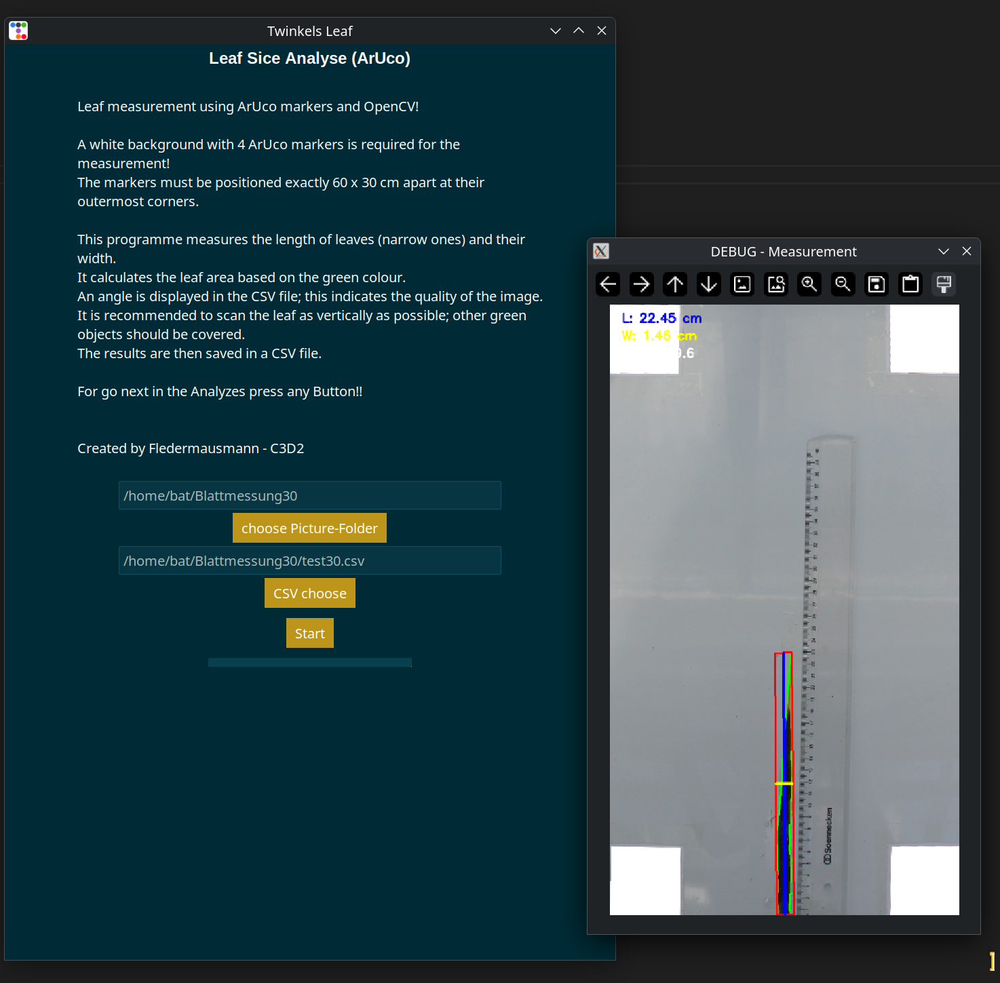
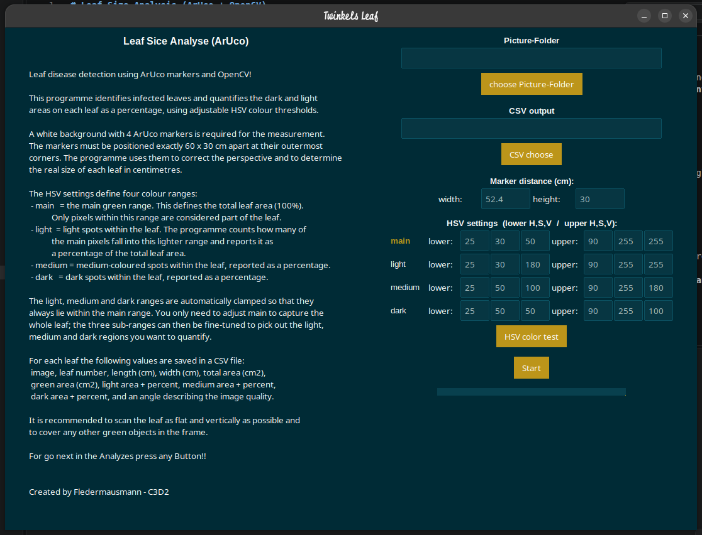

# Leaf Size Analysis (ArUco + OpenCV)

**A Python Based Tool for Automated Leaf Measurement and Quantitative Disease Scoring Using Image Processing and ArUco Markers**

Created by Fledermausmann from C3D2

---

## Background

This program was developed out of the motivation to build a **concrete, precise and repeatable tool** for measuring plants in images. The measurement must also work with **faulty input from untrained photographers**, for example different cameras, tilted perspectives or unfavorable image conditions and still deliver the same reliable results every time.

At the JKI, large numbers of leaves need to be measured by hand, which is a slow and repetitive task. In addition, the visual scoring of diseased leaves is traditionally done by human estimation, which is subjective, hard to reproduce and varies between raters. This becomes critical when two different fungal infections with similar symptoms must be told apart: for the assessment of inoculated potato leaves at the JKI, a **whitish** and a **blackish** fungal infection had to be distinguished from each other and from healthy leaf tissue with a **uniform, reproducible method that is independent of human visual estimation**.

To make this work easy and objective, this program was developed. It processes images of leaves placed on a calibrated reference background and automatically measures **length, width, area and orientation** of each leaf. In the disease scoring variant it additionally **quantifies different leaf zones, for example healthy tissue, whitish fungus and blackish infection, as percentages of the total leaf area** using adjustable HSV color ranges.

> \[!NOTE\]  
> The standard version is designed for **long leaves** like barley or similar crops.

## Main Function

This program automatically measures leaves in images:

1. **ArUco marker detection** – 4 ArUco markers in the image define the physical reference area.
2. **Perspective correction** – A homography rectifies the image to real scale, so measurements are output directly in centimeters.
3. **Marker removal** – Detected markers are overpainted in white so they cannot be mistaken for leaf tissue.
4. **Leaf segmentation** – Green areas are segmented in HSV color space and a saturation mask ignores reflections.
5. **Measurement** – For every leaf: length, width, total area and angle as an image quality indicator.
6. **Disease scoring** in the variant `Leaf_sice_desease.py` – Three adjustable color zones quantify light, medium and dark regions as percentages of the total leaf area.
7. **Output** – All results are saved to a CSV file and skipped or failed images are logged.

You can choose a complete folder with pictures. All images including subfolders are processed in natural sort order!



## Variants

The project contains two versions of the tool:


| Version                | Purpose                                                                                                                                                     |
| ---------------------- | ----------------------------------------------------------------------------------------------------------------------------------------------------------- |
| `Leaf_sice_several.py` | Pure measurement of **multiple leaves per image**: length, width, area and angle with a fixed green threshold.                                              |
| `Leaf_sice_desease.py` | Most advanced version: **disease scoring** with editable HSV ranges, an integrated HSV color tester and color zone quantification in percent for each leaf. |


## ArUco Marker Setup

> \[!IMPORTANT\]  
> **ArUco Marker Setup**  
> This software requires a **fixed reference setup**:
>
> - 4 ArUco markers must be present in every image
> - Marker dictionary: `DICT_4X4_50`
> - The markers define a physical reference area of **52.4 cm x 30 cm** at their outermost corners
> - The real size can be adjusted in the GUI under **Marker distance** with width and height, or in the code:
>
> ```python
> REAL_WIDTH_CM = 52.4
> REAL_HEIGHT_CM = 30
> ```
>
> Without correct marker placement, measurements will fail. Images with missing markers or without a detectable frame with 4 corners are skipped and logged.

## Image Processing Pipeline

### 1. Image loading and sorting

Images are collected recursively from a chosen folder with extensions jpg, jpeg and png and sorted in a **natural sort order**, so for example img2 comes before img10. This maintains chronological processing.

### 2. Marker detection and perspective correction

The 4 ArUco markers of the dictionary `DICT_4X4_50` are detected on the grayscale image. All marker corner points are combined and their convex hull is approximated to exactly 4 corner points. These define the source rectangle of a **homography** with `cv2.getPerspectiveTransform`, which warps the image onto a target coordinate system with a scale factor of **20 px per cm**. This guarantees that all measurements are in centimeters regardless of camera angle or distance.

Before segmentation, the detected markers are **overpainted in white** so that no marker pixels leak into the leaf mask.

### 3. Leaf segmentation with HSV and saturation mask

The rectified image is converted to HSV. Leaves are segmented with a green color threshold and combined with a **saturation mask** with `S > 30`, which reliably ignores reflections on the leaf surface:

```python
mask_color = cv2.inRange(hsv, lower_green, upper_green)
mask_sat = (hsv[:,:,1] > 30).astype(np.uint8) * 255
mask = cv2.bitwise_and(mask_color, mask_sat)
```

A morphological closing operation connects leaf regions and removes noise:

```python
kernel = np.ones((7,3), np.uint8)
mask = cv2.morphologyEx(mask, cv2.MORPH_CLOSE, kernel)
```

### Fixing leaves with object slides

Curled or wavy leaves distort length and area measurements. In practice, this was solved by fixing every leaf under **glass or transparent plastic with tape**: the material keeps every leaf **flat, straight and fixed** on the background. Fixing materials such as glass, transparent plastic and tape introduce their own reflections, which can for example separate a single leaf into several contours. This was corrected with the **saturation mask** described above: reflections are reliably suppressed, so every leaf is measured as one connected object. Flat leaves also improve the angle indicator in the CSV output, which describes the scan quality.

> \[!TIP\]  
> The kernel shape should match the leaf morphology. For **long leaves** like barley, use an elongated kernel such as `np.ones((25,3), np.uint8)`. For **round and broad leaves**, use a kernel like `np.ones((10,5), np.uint8)` instead.

Contours smaller than **500 px** are discarded and every remaining contour is counted as an individual leaf. In this way, **multiple leaves per image** are measured automatically.

### 4. Leaf measurement

For each detected leaf:

- **Area** – computed from the convex hull of the contour and converted to cm2 with the pixel per cm scale.
- **Length and width** – derived from the smallest rotated enclosing rectangle, always normalized so that length is the longer side.
- **Angle** – the rotation of the enclosing rectangle, saved as an indicator of how flat and vertically aligned the leaf was scanned.

### 5. Disease scoring with color zones in `Leaf_sice_desease.py`

This version extends the pipeline with **four editable HSV ranges** in the GUI:


| Range    | Meaning                                                                                                           |
| -------- | ----------------------------------------------------------------------------------------------------------------- |
| `main`   | The main green range. It defines the **total leaf area as 100 percent**. Only pixels in this range count as leaf. |
| `light`  | Light colored zones within the leaf, for example a **whitish fungal infection**.                                  |
| `medium` | Medium colored zones within the leaf.                                                                             |
| `dark`   | Dark zones within the leaf, for example a **blackish infection**.                                                 |


The light, medium and dark ranges are **automatically clamped** so they always lie within the main range. The three zones can never report pixels outside the leaf. For each leaf, the program counts how many main range pixels fall into each zone and reports it as a **percentage of the total green leaf area**. The result is a robust quantification that is independent of the rater, for example:

```
healthy / whitish fungus / blackish infection  =  62.1 % / 21.4 % / 16.5 %
```

Before analysing a whole folder, the thresholds can be fine tuned with the integrated **HSV color test**. Select a single test image and the HSV tester opens to explore suitable color ranges interactively.



### 6. Debug mode and error logging

- A **debug window** shows every analysed image with the detected leaf contours in green, the enclosing rectangles in red and the measurements for each leaf printed directly on the image: length, width, area and the light, medium and dark percentages.
- Images with missing markers, without a detectable frame or without a detected leaf are **skipped, counted as errors and logged** to `log.txt`.
- The GUI shows a progress bar and live status messages, for example `42/500 | Marker missing`.

## Output

Results are written to a CSV file, one row per leaf:

**`Leaf_sice_several.py`**


| Column        | Content                                    |
| ------------- | ------------------------------------------ |
| `image`       | Image filename                             |
| `leaf_number` | Leaf index within the image                |
| `length_cm`   | Leaf length, the longer side               |
| `width_cm`    | Leaf width                                 |
| `area_cm2`    | Leaf area from the convex hull             |
| `angle_deg`   | Rotation angle as a scan quality indicator |


**`Leaf_sice_desease.py`** additionally contains:


| Column                              | Content                                        |
| ----------------------------------- | ---------------------------------------------- |
| `area_total_cm2`                    | Total leaf area                                |
| `area_green_cm2`                    | Recognized green leaf area                     |
| `area_light_cm2`, `percent_light`   | Light zone area and its share of the leaf area |
| `area_medium_cm2`, `percent_medium` | Medium zone area and its share                 |
| `area_dark_cm2`, `percent_dark`     | Dark zone area and its share                   |


## Features

- Batch processing of image folders including subfolders with natural sort order
- Automatic ArUco marker detection with `DICT_4X4_50`
- Perspective correction with homography for measurements in centimeters
- Automatic marker removal before measurement
- Reflection suppression via an HSV saturation mask, tested with leaves fixed under glass, transparent plastic and tape
- Leaf segmentation using adjustable HSV color ranges
- Measurement of length in cm, width in cm, area in cm2 and angle in degrees
- Multiple leaves per image
- Disease scoring with light, medium and dark zones in percent of the leaf area in the desease version
- Integrated HSV color tester for threshold calibration in the desease version
- Debug window with annotations for each leaf, press any key to continue
- CSV export of results
- Error logging system to `log.txt`
- GUI built with ttkbootstrap

> \[!NOTE\]  
> This program is tested on Linux.

## Installation

```bash
git clone https://github.com/Fledermausmann-C3D2/Leaf_Sice.git
cd Leaf_Sice
python3 -m venv venv
source venv/bin/activate
pip install -r requirements.txt
```

## Usage Notes

- Place leaves on a **white background** with the 4 ArUco markers at the corners. The outer marker corners must match the configured real size.
- Place **object slides on the leaves** to keep them flat, straight and fixed. This improves the measurement and prevents curled leaves from distorting length and area.
- Scan leaves as **flat and vertically** as possible and cover any other green objects in the frame.
- Adjust `main` first to capture the whole leaf, then fine tune the three zones with the HSV tester for the regions you want to quantify.
- Press any key in the debug window to proceed to the next image.